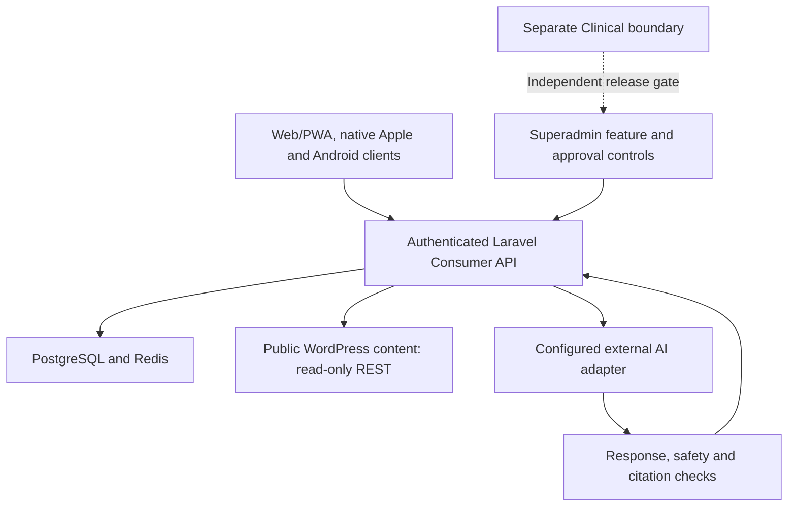

# longevity120.ai — Technical Overview

**Reviewed: 24 October 2026 · Documentation only**

longevity120.ai is a modular healthy-longevity application with distinct Consumer, Superadmin, Clinical and public-content boundaries. This document summarizes the checked application architecture without publishing its source code, private schemas, knowledge base or user data. It does not certify a live deployment or clinical readiness.

## Architecture

## Technologies

| Layer | Technologies and role |
| --- | --- |
| Consumer and administration web | React, TypeScript, Vite, React Query and shared contract packages |
| Application API | PHP 8.5, Laravel 13 and Sanctum |
| Data and operational services | PostgreSQL and Redis |
| Mobile clients | Native SwiftUI Apple client; Capacitor Android shell |
| Public content | WordPress consumed through HTTPS REST |
| Verification | Vitest/component checks, Pest/API tests and structural release validators |

Consumer wellness records belong to the authenticated application boundary. WordPress supplies public content rather than acting as the application's private patient-record database. Clinical functionality has a separate release boundary and is fail-closed by default; an administrative switch alone is not evidence of clinical readiness.

## Hybrid RAG: integration boundary

The inspected application contains an external AI-provider interface and response-validation path. **It does not itself implement a verified dense-plus-BM25 retrieval pipeline, and this review does not establish a live connection to LongevityRAG.**

A compatible hybrid RAG integration would keep retrieval behind that server-side boundary:

**Authorized query → lexical and dense retrieval → rank fusion/reranking → approved evidence → generation → application validation.**

[LongevityRAG](https://github.com/Igorrr77/longevityrag-technical-overview) describes the implemented retrieval pipeline separately. Connecting it would require an explicit connector, source-catalog mapping, privacy controls and end-to-end acceptance. The sequence above is an integration design, not a claim that the application already executes it.

The implemented AI adapter expects structured text, citation and safety data. The application checks output policy, ownership and citation membership in its approved source catalog before accepting a response. Citation membership is an identity/approval check, not scientific entailment validation; it does not by itself guarantee that an answer is grounded.

## Validation and its limits

- Request validation, authenticated ownership checks and consent boundaries protect user-specific operations.
- Disabled or unconfigured external providers fail closed; malformed provider responses are rejected.
- Feature and release gates separate Consumer capabilities from restricted Clinical functionality.
- API tests cover ownership isolation, consent, provider contracts and disabled-provider behavior. Web checks cover TypeScript, components and builds; structural validators cover API contracts and mobile/release boundaries.
- Native signing, real-provider acceptance, production database behavior and clinical validation need their own evidence. Local tests and configured adapters do not substitute for those checks.

No retrieval-quality score, model-accuracy claim, clinical certification or claim that every external integration is live is made in this overview.

## Publication boundary

Only this architectural summary is public. Source code, prompts, private knowledge, patient records, credentials, infrastructure addresses and internal operational artifacts are excluded.

Related: [LongevityRAG](https://github.com/Igorrr77/longevityrag-technical-overview) · [PainMinus.ai](https://github.com/Igorrr77/painminus-ai-technical-overview)
